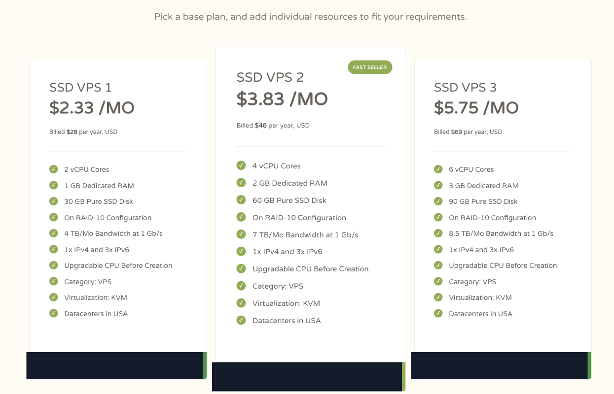
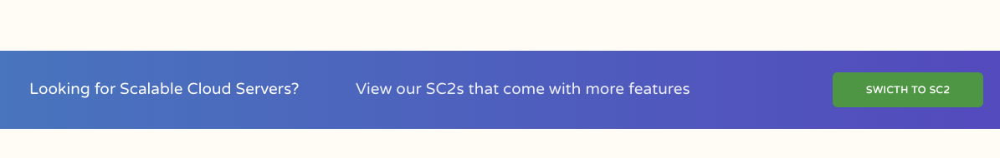
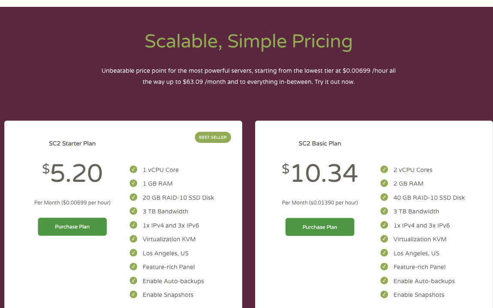

# CloudCone 中文测评：$28/年 SSD VPS 值不值得买？

> **文章整理：2026-11-09｜公开页面快照：2026-11-02**  
> 本文是购买判断，不是性能排名。本站未购买或实测本文套餐；价格、库存、税费、续费和政策会变化，付款前请以目标订单页为准。

> **推广披露：**本文含 CloudCone 的本站推广链接；通过该链接注册或购买，本站可能获得佣金。文中的普通官网链接只用于公开证据。

## 结论先行

**CloudCone 的 `$28/year` SSD VPS 适合“明确要一台美国通用小机、任务可重建、愿意先付一年”的用户；它不是 `$2.33` 月付方案，也不是已经验证的中国优化 VPS。**

2026-11-02 的官方 SSD VPS 快照把 SSD VPS 1 标为 `$2.33/MO`，但同一张卡明确写着 `Billed $28 per year, USD`。正确的购买口径是：**首期按年支付 $28**；`$2.33/MO` 是页面展示的年费月均数字，不能据此推导逐月付款、随时停付或低风险月租。

- **值得先看：**一年周期明确的个人站点、开发环境、轻量脚本、低流量服务或备用节点。
- **不应直接买：**必须中国优化、要求晚高峰已有实测、只接受月付、依赖未核实备份／快照，或不能自行维护系统的人。
- **最重要的边界：**SSD VPS 与 SC2 是两条产品线；SC2 的计费和功能不能外推到 `$28/年` SSD VPS。

[进入 CloudCone 推广入口，核对 SSD VPS 年付方案](https://app.cloudcone.com/?ref=14824)

## 公开套餐：先看年度总额，再看资源是否够用

*图注：2026-11-02 CloudCone 官方 SSD VPS 页面快照，仅裁去无关区域；价格和配置是当时的页面展示。非实时库存、非续费承诺、非本站实测。*

公开快照中的前三档如下。这里照录可见规格，不把它们当性能成绩：

| 方案 | 页面年度账单 | 公开资源 | 适合先评估的用途 | 关键限制 |
|---|---:|---|---|---|
| SSD VPS 1 | **$28/年** | 2 vCPU、1 GB Dedicated RAM、30 GB Pure SSD、4 TB/月、1 IPv4 + 3 IPv6、KVM、美国数据中心 | 轻量静态或低流量站点、脚本、监控、开发跳板 | 1 GB 内存余量小；未验证 CPU、磁盘和网络表现 |
| SSD VPS 2 | **$46/年** | 4 vCPU、2 GB RAM、60 GB Pure SSD、7 TB/月，其余卡片同列 KVM 与美国数据中心 | 需要比 1 GB 更宽松内存的小服务 | 公开核心数不等于持续独占算力 |
| SSD VPS 3 | **$69/年** | 6 vCPU、3 GB RAM、90 GB Pure SSD、8.5 TB/月，其余卡片同列 KVM 与美国数据中心 | 已能说明 3 GB 内存需求的测试或个人项目 | 升档前仍应比较真实负载与全年总成本 |

这些配置只回答“页面列了什么”，不回答“跑得多快”。本站没有做 YABS、CPU、磁盘、带宽、延迟、丢包、稳定性或中国晚高峰测试。`Dedicated RAM` 是页面文案，也不能自动证明 CPU 独占或数据库性能。

## SSD VPS 和 SC2：不要把两条产品线混成一张功能表

CloudCone 的 SSD VPS 页面在年付套餐之后明确引导读者查看 SC2，并写明 SC2 “come with more features”。这句话本身就是边界：**年付 SSD VPS 不应自动继承 SC2 的功能。**

*图注：2026-11-02 CloudCone 官方 SSD VPS 页面快照，仅裁去无关区域；用于证明官网把 SSD VPS 与 SC2 分开引导。非实时库存、非功能全量清单、非本站实测。*

SC2 首页快照中的 Starter 与 Basic 是另一组套餐，页面展示按月价格与小时价格，并列出 Feature-rich Panel、可启用 Auto-backups 和 Snapshots。它们只证明 **SC2 卡片这样展示**，不能证明 SSD VPS 1 已包含相同计费、备份、快照或面板能力。

*图注：2026-11-02 CloudCone 官方首页 SC2 套餐快照，仅裁去无关区域；用于与年付 SSD VPS 做产品线边界对照。非实时库存、非续费承诺、非本站实测。*

| 问题 | SSD VPS | SC2 | 下单时怎么做 |
|---|---|---|---|
| 这次可见的计费 | SSD VPS 1 写 `$28/year`，并给出 `$2.33/MO` 换算展示 | Starter 卡片写 `$5.20`/月及 `$0.00699`/小时 | 按目标订单的实际结账周期和总额判断，不跨产品线套用 |
| 页面定位 | General-purpose VPS，年付档位 | Scalable Cloud Compute，页面称功能更多 | 先决定要固定年度小机还是云计算产品 |
| 备份与快照 | 本轮 SSD VPS 价格卡没有证明已包含 | SC2 卡片显示可启用 Auto-backups、Snapshots | 问清是否包含、是否另收费、保留期和恢复方法 |
| 管理与弹性 | 不能从 SC2 页面反推 | SC2 页面列 Feature-rich Panel | 任何 API、弹性或自动化能力都要绑定目标产品确认 |

## 年付、首付款、续费与退出风险：分别核对

1. **年付总额：**快照中 SSD VPS 1 是 `$28/年`，这是当前证据能确认的公开页面账期。
2. **页面月均：**`$2.33/MO` 与 `Billed $28 per year` 同卡出现，只能作为商家页面的月均展示，**不是月付选项**。
3. **首付款：**若订单仍与快照一致，购买者应预期先支付完整年度；最终金额还要看结账页、税费和地区资格。
4. **续费：****未知。** 本轮证据没有建立所选 SKU 的续费价格不变。
5. **退款：****未知。** 本文不承诺可退款，也不把年付产品写成低风险试用。
6. **实时库存：****未知。** 2026-11-02 快照不是 2026-11-09 或未来时点的可售证明。

因此，不要用“每月只要 `$2.33`”作为购买结论。更准确的问题是：**我愿不愿意为这组资源先支付一年，而且即使不能退款，也能承受这笔决定？**

## 适合谁

- 预计至少使用一年，愿意支付完整年度；
- 海外用户为主，或网络路径不是业务硬条件；
- 个人站点、开发环境、轻量服务、定时任务或备用节点可随时重建；
- 能自行维护 Linux、打补丁、监控、备份并演练恢复；
- 1–3 GB 公开内存档位与真实任务估算匹配。

## 不适合谁

- 只想付一个月试错，或项目可能数周内结束；
- 把“美国数据中心”自动等同于中国优化、CN2、直连或三网晚高峰稳定；
- 需要供应商代管应用、数据库、更新或故障恢复；
- 必须确认退款、固定续费价或实时库存后才能决策；
- 想用 SC2 的小时计费、备份、快照或面板能力，却准备购买 SSD VPS；
- 需要已验证的持续 CPU、磁盘延迟、带宽或中国线路成绩。

## 公开规格如何落到用途

### 1 GB：把“可重建”放在“什么都塞进去”之前

SSD VPS 1 更适合职责单一的小任务。静态页面、轻量反向代理、小脚本或低流量服务可以评估；数据库、多个容器和监控全家桶则要先做内存预算。保留交换空间不等于解决容量不足。

### 2–3 GB：多出的内存不是性能保证

SSD VPS 2 或 3 给应用更多余量，但页面列出的 vCPU 数量不证明持续独占性能。先写出常驻内存、峰值、磁盘增长和备份空间，再决定升档；不要仅因核心数看起来多就预付一年。

### 美国数据中心：是地点信息，不是中国线路结论

快照只写 Datacenters in USA。它不能证明中国电信、联通、移动的去程／回程、晚高峰拥塞、丢包或延迟。若中国访问是硬条件，应先取得目标 SKU 和机房级资料，再用自己的运营商在真实时段测试。

## 付款前核对清单

1. **产品名：**确认订单写的是 SSD VPS，而不是 SC2；保存 SKU 与机房。
2. **首期账单：**确认结账周期、币种、税费和最终总额；不要只看 `$2.33/MO`。
3. **续费：**记录续费日期、金额和涨价规则；未知就按可能变化预算。
4. **退出条件：**确认取消、退款资格、数据保留与服务终止规则。
5. **备份恢复：**确认 SSD VPS 是否有备份／快照、是否收费、保留多久，并保留异地副本。
6. **资源政策：**核对 CPU 使用、公平使用、流量、端口、额外 IP、AUP 与滥用处理。
7. **系统职责：**确认可选 OS、重装、控制台、救援方式与支持边界。
8. **网络：**取得目标机房资料；中国用户用自己的运营商测工作日和晚高峰。
9. **容量：**按真实应用计算 RAM、磁盘增长和流量，不用公开核心数替代容量评估。
10. **先备后买：**先写好部署与恢复步骤，再决定是否值得锁定一年。

## 最终建议

如果你要的是一台**美国通用、可重建、计划持有一年**的小 VPS，且 1 GB 资源足够，CloudCone SSD VPS 1 的 `$28/年` 是清楚可比较的年度账单。若你只想短期尝试、要求中国优化或依赖 SC2 功能，就不要被 `$2.33/MO` 的换算展示带着走。

购买前仍要在目标订单确认：产品线、实时库存、首期总额、续费、退款、备份与机房。确认这些条件后，再从本站推广入口进入：

[进入 CloudCone 推广入口，核对 SSD VPS 年付方案](https://app.cloudcone.com/?ref=14824)

## 来源与未实测边界

- [CloudCone SSD VPS 普通官网证据页](https://cloudcone.com/vps/)：用于核对年付套餐、公开规格及 SSD VPS／SC2 引导边界。
- [CloudCone 普通官网首页](https://cloudcone.com/)：用于核对 SC2 卡片的独立计费与功能展示。
- 截图均为 **2026-11-02** 官方公开页面快照，只做像素不变裁切；不是实时库存或完成结账的证明。
- 本站未购买本文套餐，未运行性能、线路、稳定性、备份恢复或中国三网晚高峰测试。
- 本文不声称最低价、中国优化、可退款、续费不变、库存可用或 SC2 功能适用于 SSD VPS。
- **v1.0 · 2026-11-09** — 建立 CloudCone 中文单站购买判断，分开 SSD VPS 与 SC2，并把 `$28/年`、首付款和未知续费边界写清。
